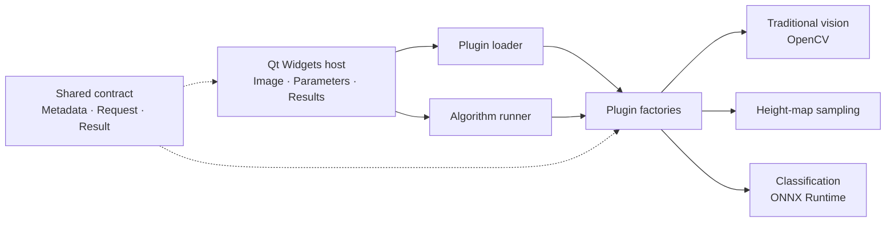

# OnePiece

English · [简体中文](README.zh-CN.md)

**A C++17 / Qt 6 algorithm plugin workbench for learning machine vision and desktop software engineering.**

Load an image, select an algorithm, adjust its parameters, and inspect the result. OnePiece separates the Qt Widgets application from algorithm implementations through a shared plugin contract and factory interface.


## What it demonstrates

| Area | Implementation |
| --- | --- |
| Plugin architecture | Discover DLLs with QPluginLoader, obtain a factory, and create algorithm instances through shared interfaces |
| Traditional vision | OpenCV binary thresholding, Canny edge detection, and external contour extraction |
| Height-map sampling | Interpret grayscale intensity as height, sample points, calculate mean height, and draw a depth preview |
| Model inference | Optional ONNX Runtime CPU inference with a MobileNet-style input and a top-1 class index and score |
| Desktop workflow | Parameter forms generated from metadata, input preview, result preview, and execution logs |

This is a personal learning project. Height-map sampling uses image intensity, not physical measurements; the average-height calculation is not a general plane-fitting algorithm. Inference expects a compatible float32 classification model, and the current interface displays class indices without a label map. The UI is currently in Simplified Chinese; documentation is available in both languages.

## Architecture



```text
app/           Qt application, plugin discovery, and execution
contracts/     Factory and algorithm interfaces; metadata and data types
shared/        QImage / OpenCV conversion and preview helpers
plugins/
  traditional_vision/
  point_cloud/
  deep_learning/
examples/      Synthetic image for a first run
doc/           Bilingual guides and screenshots
```

## Build on Windows

Requirements: Windows x64, Visual Studio 2022 with Desktop development with C++, Qt 6 for MSVC x64, and CMake 3.25 or later. OpenCV is required. ONNX Runtime and a compatible model are optional.

1. Clone the repository.
2. Prepare the dependency folders described in [Dependencies](doc/dependencies.md).
3. Configure and build in PowerShell:

```powershell
git clone https://github.com/KangC-Xu/OnePiece.git
cd OnePiece
cmake --preset default "-DCMAKE_PREFIX_PATH=C:/Qt/6.10.1/msvc2022_64"
cmake --build --preset release
.\build\app\AlgorithmTeachingPlatform.exe
```

Adjust the Qt path to your installation. To keep dependencies outside the checkout, add `-DATP_THIRD_PARTY_DIR=C:/dev/onepiece-dependencies` to the configure command; the directory must use the layout in the dependency guide.

The build uses the existing Windows MSVC setup and release libraries. Linux, macOS, and Debug builds have not been validated. Qt deployment runs automatically; the application expects the Visual C++ x64 runtime to be installed.

## Try it

1. Select the traditional vision plugin.
2. Open [examples/shapes.png](examples/shapes.png).
3. Choose thresholding, Canny, or contours, then run the algorithm.
4. Switch to the height-map plugin to compare sampling steps and mean intensity.

For classification, prepare a compatible ONNX model and enter its path in the model-path field. The default path is `3rd/models/mobilenet/mobilenet_v2.onnx`. Model weights are not included.

## Read the code

Start with the [learning guide](doc/learning-path.md). The repository focuses on the current algorithm workbench; earlier C++ exercises and unrelated projects are outside this release.

Execution is synchronous in the UI thread, so large images or inference can temporarily block the window. Load only plugins you trust: native plugins execute inside the host process. This version is intended for learning and experimentation.

## License

Original source, documentation, and the synthetic example image are released under the [MIT License](LICENSE). Qt, OpenCV, ONNX Runtime, and any separately obtained models retain their own licenses; see [Dependencies](doc/dependencies.md).
