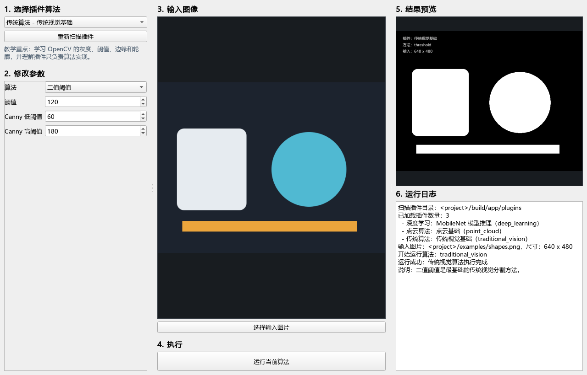
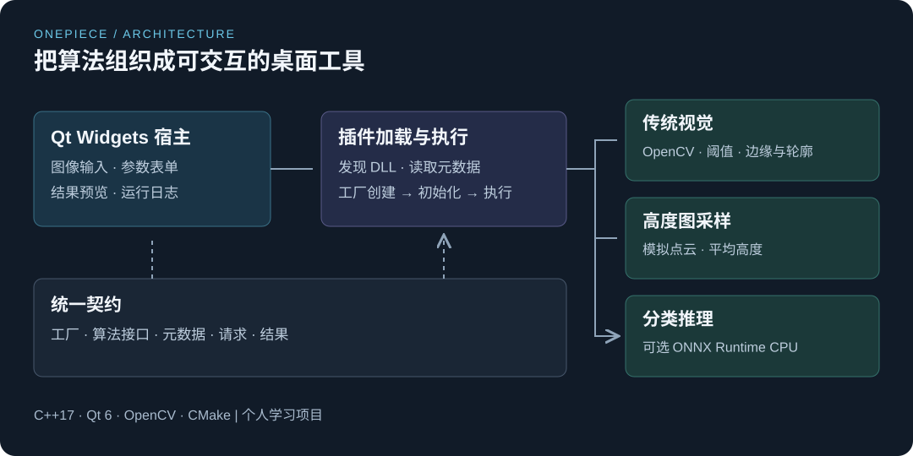

# OnePiece

[English](README.md) · 简体中文

**使用 C++17 / Qt 6 编写的算法插件学习平台，实践机器视觉算法与桌面软件开发。**

选择图像、切换算法、调整参数，再查看处理结果。平台通过统一的插件接口和工厂接口，把 Qt Widgets 界面与具体算法分开。



## 实现内容

| 方向 | 实现 |
| --- | --- |
| 插件架构 | 使用 QPluginLoader 发现 DLL，取得工厂，通过统一接口创建算法实例 |
| 传统视觉 | OpenCV 二值阈值、Canny 边缘检测、外部轮廓提取 |
| 高度图采样 | 将灰度值作为模拟高度，进行采样、平均高度统计与深度图预览 |
| 模型推理 | 可选的 ONNX Runtime CPU 推理，使用 MobileNet 风格输入，输出 Top1 类别索引和分数 |
| 桌面交互 | 根据算法元数据生成参数表单，展示输入、结果和运行日志 |

这是个人学习项目。高度图采样使用图像灰度，不代表真实物理测量；平均高度计算也不是通用平面拟合。推理需要匹配的 float32 分类模型，目前显示类别索引，尚未加入标签映射。界面为简体中文，文档提供中英文版本。

## 结构



```text
app/           Qt 应用、插件发现与算法执行
contracts/     工厂与算法接口、元数据和输入输出类型
shared/        QImage / OpenCV 转换与预览工具
plugins/
  traditional_vision/
  point_cloud/
  deep_learning/
examples/      首次运行使用的合成示例图
doc/           中英文指南与界面截图
```

## Windows 构建

需要 Windows x64、Visual Studio 2022 的“使用 C++ 的桌面开发”工作负载、MSVC x64 版本的 Qt 6，以及 CMake 3.25 或更高版本。OpenCV 为必需依赖，ONNX Runtime 和模型文件为可选依赖。

1. 克隆仓库。
2. 按[依赖说明](doc/dependencies.zh-CN.md)准备第三方目录。
3. 在 PowerShell 中配置并构建：

```powershell
git clone https://github.com/KangC-Xu/OnePiece.git
cd OnePiece
cmake --preset default "-DCMAKE_PREFIX_PATH=C:/Qt/6.10.1/msvc2022_64"
cmake --build --preset release
.\build\app\AlgorithmTeachingPlatform.exe
```

Qt 路径请按实际安装位置修改。若依赖放在仓库外，可在配置命令中增加 `-DATP_THIRD_PARTY_DIR=C:/dev/onepiece-dependencies`，对应目录结构见依赖说明。

构建沿用 Windows MSVC 配置并链接 Release 依赖库。Linux、macOS 和 Debug 构建尚未验证。构建过程会自动部署 Qt 运行库，电脑上需要安装 Visual C++ x64 运行库。

## 第一次运行

1. 选择传统视觉插件。
2. 打开 [examples/shapes.png](examples/shapes.png)。
3. 选择阈值、Canny 或轮廓方法，运行并观察结果。
4. 切换到高度图插件，观察不同采样步长下的点数和平均灰度值。

分类推理需要自行准备匹配的 ONNX 模型，并在“模型路径”中填写位置。默认路径为 `3rd/models/mobilenet/mobilenet_v2.onnx`，仓库不附带模型权重。

## 阅读代码

可按[学习路线](doc/learning-path.zh-CN.md)阅读。本次发布聚焦当前算法平台，早期 C++ 练习和其他项目不在本次发布范围内。

算法目前在界面线程同步执行，大图像或模型推理期间可能短暂阻塞界面。原生插件会在宿主进程内执行，因此只加载可信插件。当前版本用于学习和实验。

## 许可证

原创源码、文档和合成示例图采用 [MIT 许可证](LICENSE)。Qt、OpenCV、ONNX Runtime 以及单独下载的模型各自遵循其许可证，详见[依赖说明](doc/dependencies.zh-CN.md)。
